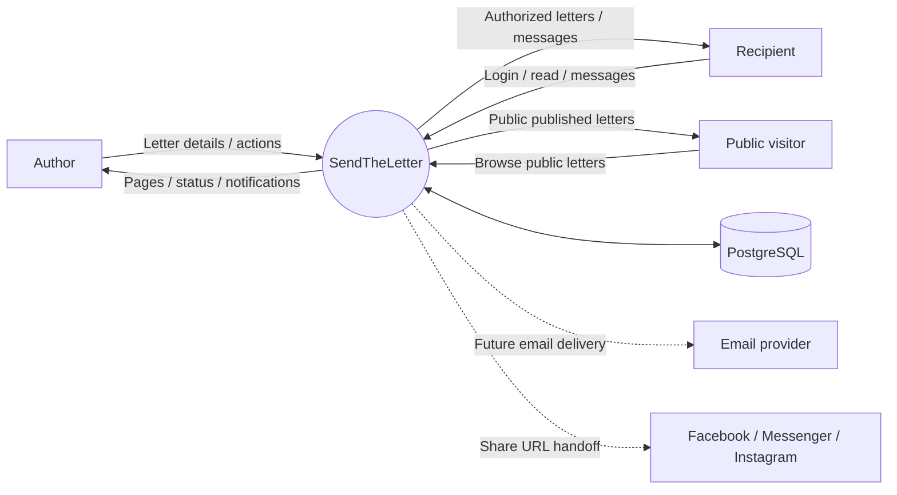
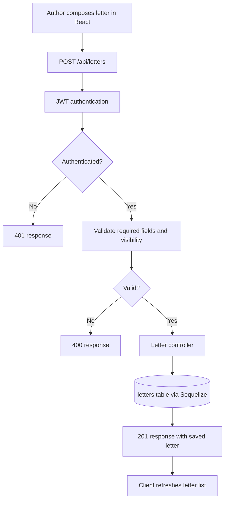
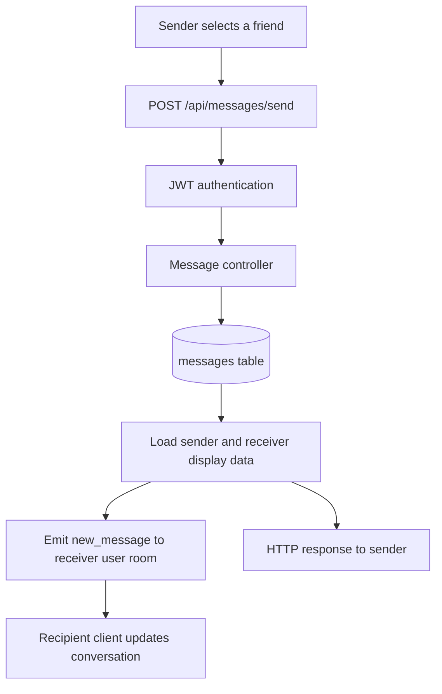
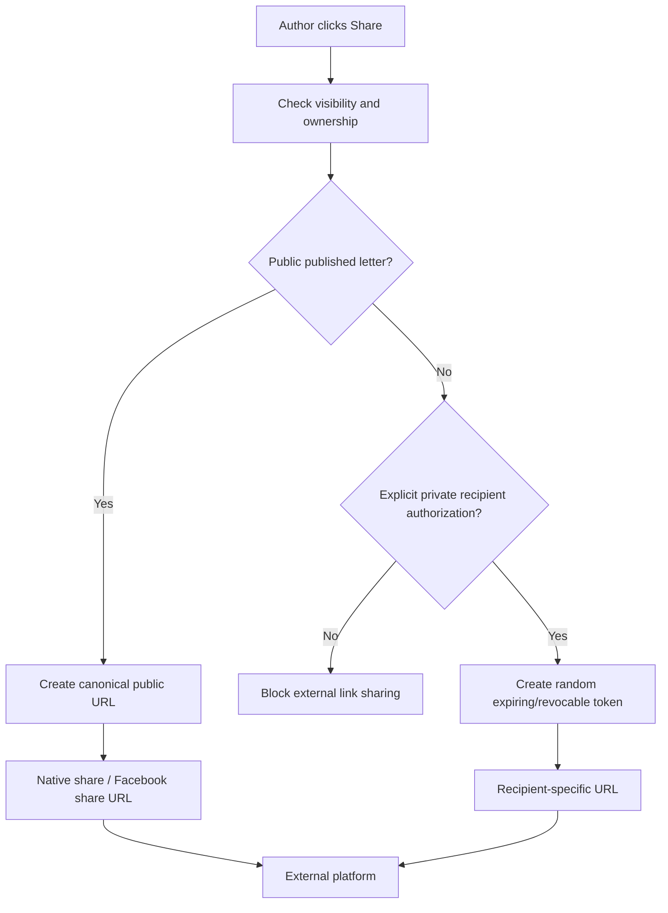

# Data Flow Diagrams

## DFD Level 0 — system boundary

## DFD Level 1 — create a letter

## DFD Level 1 — current in-app message

## DFD Level 1 — proposed external share

The external-share flow is a target design. A public route and secure private-token implementation must exist before enabling these actions.
