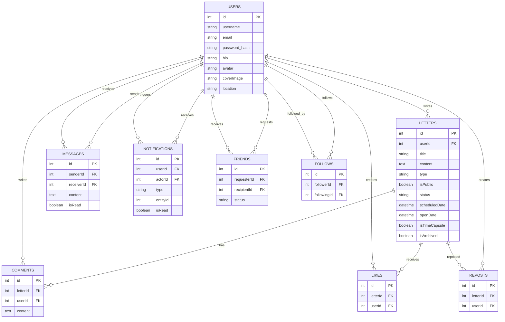

# Database / ER Model

This ER view is based on Sequelize models currently present in `Note_letter/server/src/models`. It is a logical summary; confirm exact deployed constraints and indexes against the live database before migrations.

## Current gaps relative to planned features

- No recipient user ID or verified recipient email field is present in the Letter model inspected.
- No share-token model, delivery-attempt table, or durable job/outbox model was found.
- Existing Notification `entityId` is polymorphic in practice and is not a declared foreign key to every entity type.
- Scheduled fields exist, but the worker that acts on them is absent.
- Confirm Comment, Like, Follow, and Repost constraints/indexes from their model files and live schema before making ER guarantees.
