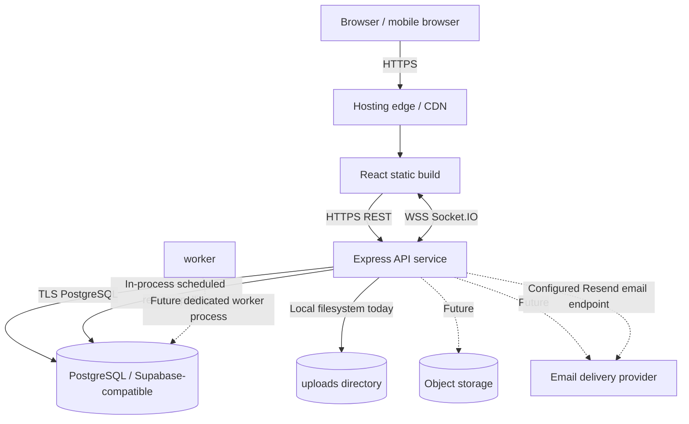

# Deployment Architecture

## Current deployment artifacts

Repository contains a frontend Dockerfile, Nginx configuration, Vercel configuration, and a backend Dockerfile. The actual production hosting provider, environment variables, domain, database plan, and deployment health were not verifiable from source alone.

## Production requirements

- Serve frontend and API over HTTPS; configure exact allowed origins.
- Keep `DATABASE_URL`, `JWT_SECRET`, email keys, and provider credentials in hosting secrets, never in Vite variables or Git.
- Use a managed PostgreSQL database with backups and reviewed migrations.
- Move uploads to durable object storage before horizontal scaling.
- Run the scheduled-delivery worker as a separately monitored process or managed job.
- Add health/readiness endpoints, structured logs, error monitoring, and alerting.
- Verify Socket.IO sticky-session / adapter requirements if multiple API replicas are used.
- Do not use `sequelize.sync({ alter: true })` as the production migration strategy.

## Release checklist

1. Build frontend and backend from clean lockfile installs.
2. Run TypeScript checks and API tests.
3. Apply reviewed database migrations to staging.
4. Verify auth, private/public access, file uploads, realtime, and email sandbox delivery.
5. Run security and dependency audits.
6. Deploy to staging, smoke test, then promote.
7. Confirm rollback and backup restore procedures.
