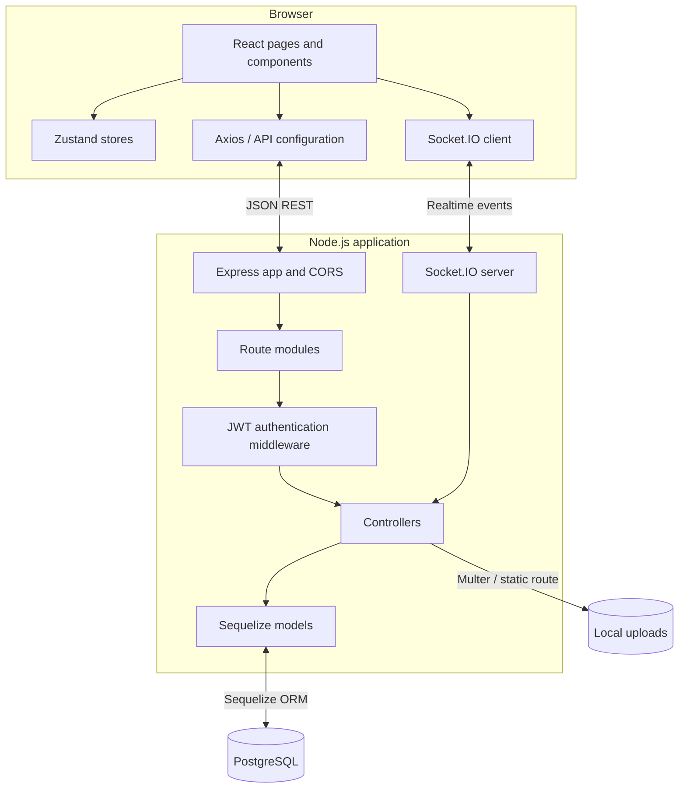

# System Architecture

## Implemented logical architecture

## API module map

| Mount path | Current responsibility |
| --- | --- |
| `/api/auth` | Registration, login, profile update |
| `/api/letters` | Letter create/read/update/delete, public feed, drafts, scheduled listing, archive, likes/comments/reposts |
| `/api/notifications` | Notification list and mark-as-read |
| `/api/users` | Follow-related routes |
| `/api/messages` | Conversations, message send/read |
| `/api/friends` | Friend requests and accepted friends |

## Proposed production additions

These are architectural recommendations, not claims about deployed components:

- The current scheduled-release poller runs inside the API process; a dedicated worker process/queue is recommended for production isolation and independent scaling.
- An email adapter (Resend or another selected provider) behind a server-side service interface.
- Durable object storage for uploads.
- A share-link service with random, revocable tokens and explicit permission checks.
- A transactional outbox or durable job table for retryable delivery and notification work.
- Structured logs, health checks, rate limiting, and metrics.

## Request lifecycle

1. Client submits an HTTPS request.
2. Express routes the request to a route module.
3. Protected routes run JWT authentication middleware.
4. Controller validates the input and checks resource ownership/permissions.
5. Sequelize reads or writes PostgreSQL.
6. Controller returns a minimal response.
7. For realtime updates, the server emits an event only to an authenticated, authorized socket room.

## Architectural risks found during inspection

- This PR adds JWT-authenticated Socket.IO handshakes and server-side room authorization. Add integration tests for expired tokens, user-room isolation, and private/public letter-room access before production.
- Express CORS is currently permissive, and Socket.IO has a localhost-only origin setting.
- `sequelize.sync({ alter: true })` runs on server startup; production schema changes should move to reviewed migrations.
- The current server has no scheduled-delivery worker or email adapter.
- Local uploads are not suitable as shared durable storage across ephemeral/multiple server instances.
