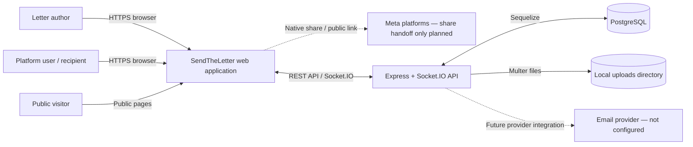

# System Context Diagram

## Current context

## Actors and responsibilities

| Actor / system | Responsibility |
| --- | --- |
| Author | Creates letters, edits drafts, chooses visibility, and initiates sharing. |
| Recipient | Reads letters they are authorized to access and participates in conversations. |
| Public visitor | Can browse only public, published content exposed by public API routes. |
| React client | Renders pages, manages client state, sends API requests, and maintains the Socket.IO client connection. |
| Express API | Validates requests, authenticates users, applies business rules, and accesses persistence. |
| PostgreSQL | Stores users, letters, social relationships, messages, and notifications through Sequelize models. |
| Local upload directory | Stores uploaded images on the server filesystem; production should migrate to durable object storage. |
| Email / Meta | External integrations are planned, not currently connected. |

## Trust boundaries

1. Browser to API: HTTPS, bearer-token validation, input validation, rate limiting.
2. API to database: server-only database credentials and least-privilege access.
3. API to file storage: validate file content and size; never trust client MIME type alone.
4. API to email provider: server-side API key only; redact provider errors and recipient data from logs.
5. Social platforms: share only public URLs or explicitly authorized content; do not imply unrestricted DM/posting permissions.
